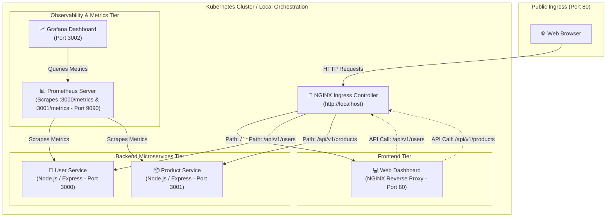

# 🚀 Cloud-Native Microservices Web Application & CI/CD Pipeline

A modern, enterprise-grade cloud-native microservices application built with **Node.js/Express**, containerized with **Docker**, orchestrated locally via **Docker Compose**, deployed on **Kubernetes** using **Helm**, monitored with **Prometheus & Grafana**, and automated end-to-end with **GitHub Actions CI/CD** publishing to **GitHub Container Registry (GHCR)**.

---

## 🏛️ System Architecture



---

## 📦 Microservices & Components

| Component | Technology | Internal Port | External Route / Port | Purpose |
| :--- | :--- | :--- | :--- | :--- |
| **Frontend** | HTML5, CSS3, Vanilla JS, NGINX Alpine | `80` | `http://localhost/` (Ingress) or `:8080` (Compose) | Responsive Dashboard displaying registered users & products |
| **User Service** | Node.js, Express, Jest, Supertest | `3000` | `http://localhost/api/v1/users` | REST API managing registered users and account data |
| **Product Service** | Node.js, Express, Jest, Supertest | `3001` | `http://localhost/api/v1/products` | REST API managing cloud product catalog and pricing |
| **Prometheus** | Prometheus v2.51.0 | `9090` | `http://localhost:9090` | Scrapes cloud-native `/metrics` targets every 5 seconds |
| **Grafana** | Grafana 10.4.0 | `3000` | `http://localhost:3002` | Real-time observability dashboard for runtime monitoring |

---

## 🚀 Quickstart Options

### Option 1: Run with Docker Compose (Local Development)

To start the entire microservices stack along with Prometheus and Grafana in one command:

```bash
docker compose up -d --build
```

* **Frontend Dashboard:** [http://localhost:8080](http://localhost:8080)
* **User Service Health:** [http://localhost:3000/healthz](http://localhost:3000/healthz)
* **Product Service Health:** [http://localhost:3001/healthz](http://localhost:3001/healthz)
* **Prometheus Targets:** [http://localhost:9090/targets](http://localhost:9090/targets)
* **Grafana Dashboard:** [http://localhost:3002](http://localhost:3002) (Login: `admin` / `admin`)

To shut down:
```bash
docker compose down
```

---

### Option 2: Deploy with Helm (Production Kubernetes)

Package and deploy all microservices and Ingress using Helm:

```bash
# Deploy or upgrade the Helm chart in the microservices-app namespace
helm upgrade --install microservices-app ./helm/microservices-app \
  --namespace microservices-app \
  --create-namespace
```

To view deployed resources:
```bash
kubectl get all,ingress -n microservices-app
```

To uninstall:
```bash
helm uninstall microservices-app -n microservices-app
```

---

### Option 3: Deploy with Raw Kubernetes Manifests

```bash
# 1. Create Namespace
kubectl apply -f k8s/namespace.yaml

# 2. Deploy Services, Deployments, and Ingress
kubectl apply -f k8s/
```

Access the application via NGINX Ingress at:
* **Dashboard:** [http://localhost/](http://localhost/)
* **Users API:** [http://localhost/api/v1/users](http://localhost/api/v1/users)
* **Products API:** [http://localhost/api/v1/products](http://localhost/api/v1/products)

---

## 🔄 CI/CD Pipeline Architecture

This repository uses automated **GitHub Actions** workflows:

1. **Continuous Integration (`.github/workflows/ci.yml`):**
   * Automatically triggered on pull requests and pushes to `main`.
   * Sets up Node.js 20 on Ubuntu runners.
   * Runs clean dependency installation (`npm ci`).
   * Executes unit and integration test suites via Jest & Supertest across all backend services in parallel.

2. **Continuous Delivery (`.github/workflows/cd.yml`):**
   * Automatically triggered on pull requests (test build) and pushes to `main` (build & push).
   * Authenticates with **GitHub Container Registry (GHCR)** using `${{ secrets.GITHUB_TOKEN }}`.
   * Compiles multi-stage, non-root Alpine Docker images for `user-service`, `product-service`, and `frontend`.
   * Publishes images tagged with `:latest` and `:sha-<commit>` directly to GitHub Packages.

---

## 🔒 Security Best Practices Implemented

* **Unprivileged Non-Root Containers:** All Node microservices run under `USER node` and NGINX runs on Alpine to minimize attack surfaces.
* **Kubernetes Resource Governance:** Every pod has strict CPU and Memory `requests` and `limits` to prevent noisy-neighbor starvation.
* **Zero-Downtime Rolling Releases:** Combined `readinessProbe` and `livenessProbe` with `maxUnavailable: 0` ensures zero-downtime updates.
* **Path-Based Reverse Proxying:** NGINX handles clientside API requests internally, eliminating browser CORS vulnerabilities.

---

## 👨‍💻 Author
**Deemantha Gunasekara**  
*Cloud & DevOps Engineering Project*